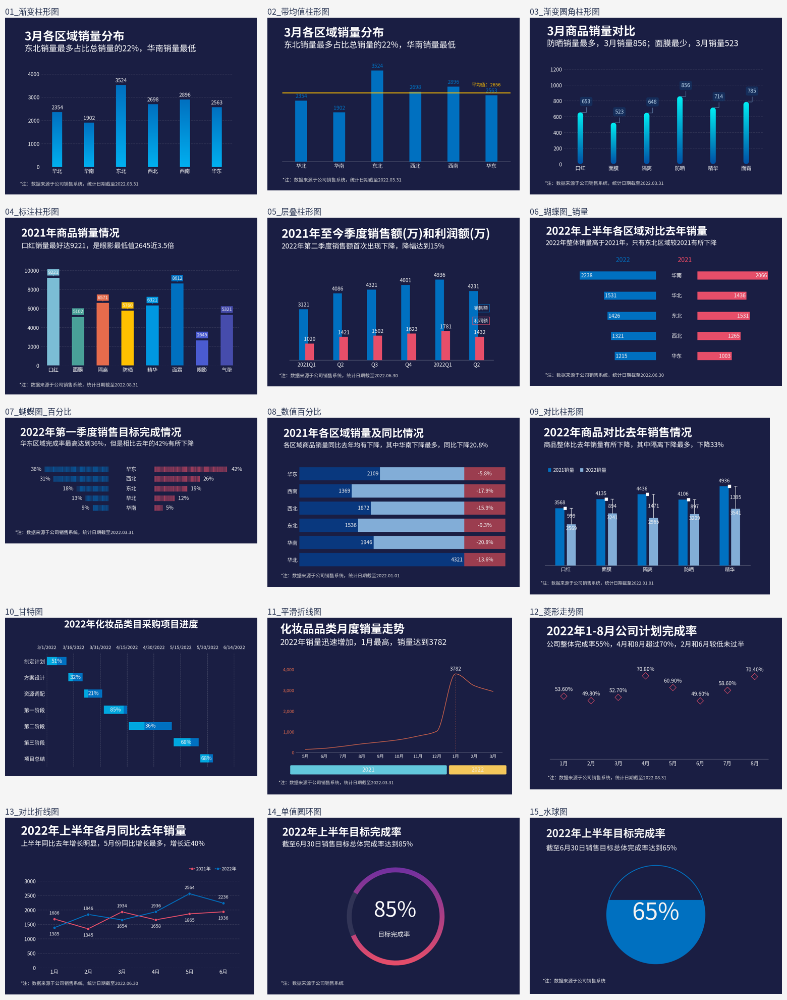

# Excel 数据可视化：前 15 图的 Jupyter 复刻

使用 **pandas、NumPy 与 Matplotlib**，将 Excel 数据转换为 15 种可视化图表。Notebook 逐图给出读取、计算、绘制代码和生成结果，保留原模板的深蓝背景、主要配色、图表结构、标题、标签和图例。



## 快速开始

已验证环境为 **Python 3.12**。建议使用该版本和随附依赖文件。

```bash
python -m pip install -r requirements-notebook.txt
python -m notebook
```

在 Jupyter 中打开 [notebooks/01_first_15_charts.ipynb](notebooks/01_first_15_charts.ipynb)，选择 Python 3 内核，再选择“运行所有单元格”。先执行公共设置单元格，即可单独运行任一图表。

图表会依次显示，并保存到 `outputs/charts/`。源码从脚本或 Notebook 的工作目录向上查找项目根目录，因此可以从仓库根目录或 `notebooks/` 启动。

### 不打开 Notebook 批量生成

```bash
python -m pip install -r requirements.txt
python scripts/render_all.py
```

只生成第 3 图：

```bash
python scripts/render_all.py --chart 3
```

验证生成结果：

```bash
python scripts/check_project.py
```

## 文件结构

| 路径 | 内容 |
| --- | --- |
| `notebooks/01_first_15_charts.ipynb` | 完整 Jupyter 代码与已生成的图形输出 |
| `src/chart_common.py` | 数据读取、中文字体、模板布局和绘图工具 |
| `src/charts.py` | `chart_01` 至 `chart_15`，15 个独立绘图函数 |
| `scripts/render_all.py` | 批量或单图运行入口 |
| `scripts/check_project.py` | 输入、Notebook 和 PNG 检查 |
| `data/第二章 图表(前15).xlsx` | 原始数据与样式，未修改 |
| `assets/charts/` | 随项目提交的 15 张示例 PNG |
| `assets/preview.png` | README 总览 |
| `assets/fonts/` | 思源黑体备选字体及 OFL 许可证 |
| `docs/reproduction-notes.md` | 复刻方法、已知差异和验证范围 |
| `.github/workflows/validate.yml` | 提交后自动生成并检查 15 张图 |
| `outputs/charts/` | 本地重新生成的结果，默认不提交 |

## 图表清单

各图读取相同编号的工作表，下面的单元格区域包含表头。

| 编号 | 图表 | 数据区域 | 示例 |
| --- | --- | --- | --- |
| 01 | 渐变柱形图 | `B2:C8` | [PNG](assets/charts/01_渐变柱形图.png) |
| 02 | 带均值柱形图 | `B2:D8` | [PNG](assets/charts/02_带均值柱形图.png) |
| 03 | 渐变圆角柱形图 | `B2:C8` | [PNG](assets/charts/03_渐变圆角柱形图.png) |
| 04 | 标注柱形图 | `B2:C10` | [PNG](assets/charts/04_标注柱形图.png) |
| 05 | 层叠柱形图 | `B2:D8` | [PNG](assets/charts/05_层叠柱形图.png) |
| 06 | 蝴蝶图 销量 | `B2:F7` | [PNG](assets/charts/06_蝴蝶图_销量.png) |
| 07 | 蝴蝶图 百分比 | `B2:D7` | [PNG](assets/charts/07_蝴蝶图_百分比.png) |
| 08 | 数值百分比 | `B2:F8` | [PNG](assets/charts/08_数值百分比.png) |
| 09 | 对比柱形图 | `B2:E7` | [PNG](assets/charts/09_对比柱形图.png) |
| 10 | 甘特图 | `B3:G10` | [PNG](assets/charts/10_甘特图.png) |
| 11 | 平滑折线图 | `B2:D13` | [PNG](assets/charts/11_平滑折线图.png) |
| 12 | 菱形走势图 | `B2:C10` | [PNG](assets/charts/12_菱形走势图.png) |
| 13 | 对比折线图 | `B2:D8` | [PNG](assets/charts/13_对比折线图.png) |
| 14 | 单值圆环图 | `B2:C3` | [PNG](assets/charts/14_单值圆环图.png) |
| 15 | 水球图 | `B2:C3` | [PNG](assets/charts/15_水球图.png) |

## 数据更新

修改 `data/` 下原 Excel 对应的数据单元格，再运行 Notebook 或脚本。均值、差值、占位段、甘特图完成长度、圆环完成率和水位会随数据重新计算。请保留 Excel 的原工作表名称、数据位置和图表样式对象，代码会读取其中的标题与布局。

固定的模板说明、统计日期和坐标轴上限需要随数据变化同步核对。中文字体优先使用微软雅黑，没有时使用随附思源黑体。

## 复刻范围

这是可重算的代码复刻，不能保证与 Excel 截图逐像素相同。字体、换行、抗锯齿、局部标签和曲线插值可能有细微差别。第 12 图按原 XML 隐藏连接线，第 14 图按原 XML 的 90% 内径绘制，第 15 图用几何裁切替代图片填充。详见 [复刻说明](docs/reproduction-notes.md)。

## 提交到 GitHub

在 GitHub 新建空仓库，然后在本目录执行以下命令。把最后一条 URL 替换为你的仓库地址。

```bash
git init
git branch -M main
git add .
git commit -m "Add 15 Excel chart reproductions with Jupyter"
git remote add origin https://github.com/YOUR_USERNAME/excel-visualization-jupyter.git
git push -u origin main
```

`.gitignore` 已排除缓存、虚拟环境、环境配置文件和本地重新生成的输出。README 的示例图片、中文字体、原始 Excel 和 Notebook 会正常提交。

## 验证

15 个绘图函数已在 Python 3.12 / Matplotlib Agg 后端逐一执行，全部生成 PNG。另验证了柱高、均值线和水位对输入数据变化的响应，并核对原始 Excel 字节未变。Notebook 保存了实际 Python 执行产生的图形输出；当前验证环境没有安装 Jupyter 内核，尚未进行内核级“运行全部”测试。

GitHub Actions 使用相同的渲染和检查入口；配置参考 [GitHub 官方 Python 工作流文档](https://docs.github.com/en/actions/tutorials/build-and-test-code/python)。远程 Actions 尚未触发。
