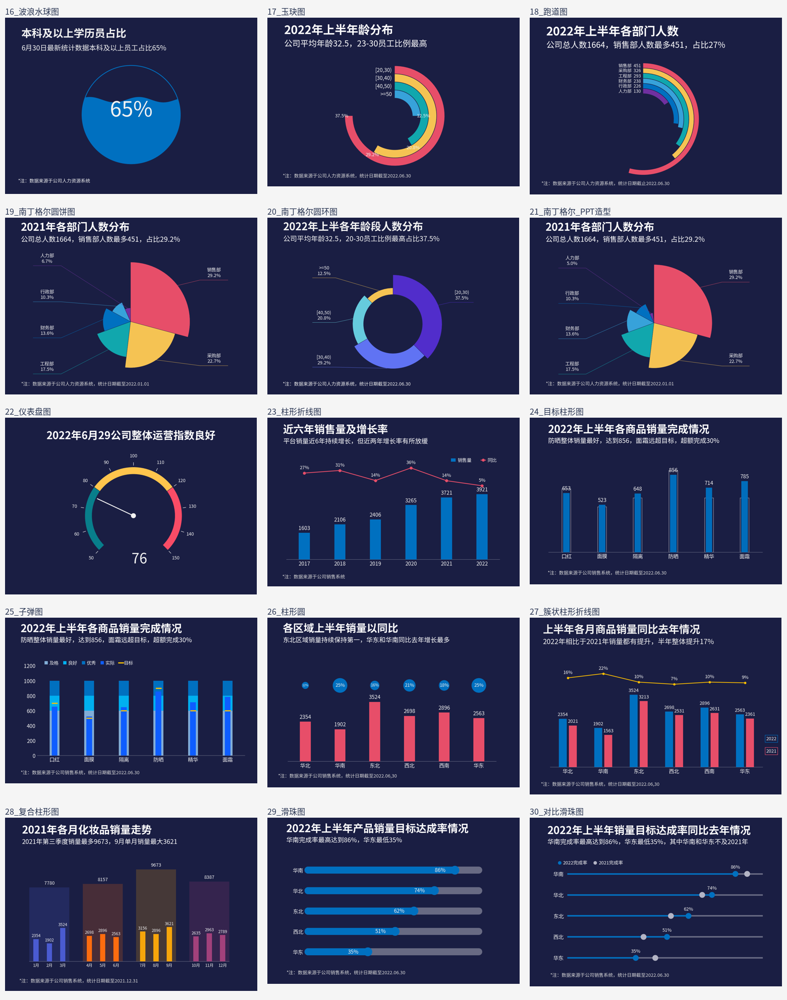

# 后 15 图 Excel 可视化：Jupyter 复刻

独立的第 **16—30 图**项目，从随附 Excel 读取数据，使用 pandas、NumPy、Matplotlib 生成后 15 张图。Notebook 分图提供完整读取、计算和绘制代码，附有实际 Python 执行产生的图形输出。



## Jupyter 运行

已验证环境为 **Python 3.12**。先解压项目并保留目录结构，然后在项目目录执行：

```bash
python -m pip install -r requirements-notebook.txt
python -m notebook
```

打开 [notebooks/last_15_charts.ipynb](notebooks/last_15_charts.ipynb)，选择 Python 3 内核，运行全部单元格。若只需一张图，先运行公共设置单元格，再运行对应图表单元格。

结果显示在 Notebook 中，并保存到 `outputs/charts/`。路径可从项目根目录或 notebooks 目录自动定位。中文优先使用微软雅黑，无该字体时使用随附思源黑体。

## 脚本运行

```bash
python -m pip install -r requirements.txt
python scripts/render_all.py
python scripts/check_project.py
```

单独生成某一张，例如第 16 图：

```bash
python scripts/render_all.py --chart 16
```

## 目录

| 路径 | 内容 |
| --- | --- |
| `notebooks/last_15_charts.ipynb` | 公共设置、15 个图表代码单元格及生成结果 |
| `src/charts.py` | chart_16 至 chart_30 的独立函数 |
| `src/chart_common.py` | 数据读取、字体、模板文本和绘图工具 |
| `data/第二章 图表(后15).xlsx` | 随附的一份原始 Excel，内容未修改 |
| `assets/charts/` | 15 张代码生成的示例 PNG |
| `assets/fonts/` | 中文备选字体及 OFL 许可证 |
| `scripts/render_all.py` | 全部或单图生成入口 |
| `scripts/check_project.py` | Notebook 语法、输入与图片检查 |
| `docs/reproduction-notes.md` | 复刻差异、特殊数据映射和验证范围 |
| `.github/workflows/validate.yml` | 自动绘图、检查和执行 Notebook |
| `outputs/` | 本地重生成的结果，默认不提交 |

## 图表与数据区域

编号 16—30 对应 Excel 中的第 1—15 个工作表，区域包含表头。

| 编号 | 图表 | 数据区域 | 示例 |
| --- | --- | --- | --- |
| 16 | 波浪水球图 | `B3:C4` | [PNG](assets/charts/16_波浪水球图.png) |
| 17 | 玉玦图 | `B2:D6` | [PNG](assets/charts/17_玉玦图.png) |
| 18 | 跑道图 | `B2:D8` | [PNG](assets/charts/18_跑道图.png) |
| 19 | 南丁格尔圆饼图 | `B2:C8` | [PNG](assets/charts/19_南丁格尔圆饼图.png) |
| 20 | 南丁格尔圆环图 | `B2:C6` | [PNG](assets/charts/20_南丁格尔圆环图.png) |
| 21 | 南丁格尔 PPT造型 | `B2:C8` | [PNG](assets/charts/21_南丁格尔_PPT造型.png) |
| 22 | 仪表盘图 | `H2:H3、B2:B23` | [PNG](assets/charts/22_仪表盘图.png) |
| 23 | 柱形折线图 | `B2:D8` | [PNG](assets/charts/23_柱形折线图.png) |
| 24 | 目标柱形图 | `B2:D8` | [PNG](assets/charts/24_目标柱形图.png) |
| 25 | 子弹图 | `B3:G9` | [PNG](assets/charts/25_子弹图.png) |
| 26 | 柱形圆 | `B2:E8` | [PNG](assets/charts/26_柱形圆.png) |
| 27 | 簇状柱形折线图 | `B2:E8` | [PNG](assets/charts/27_簇状柱形折线图.png) |
| 28 | 复合柱形图 | `B2:D17` | [PNG](assets/charts/28_复合柱形图.png) |
| 29 | 滑珠图 | `B2:E7` | [PNG](assets/charts/29_滑珠图.png) |
| 30 | 对比滑珠图 | `B3:F8` | [PNG](assets/charts/30_对比滑珠图.png) |

第 16、25、30 图表头在第 3 行；第 16 图完成率为 B4。第 21 图对应原名“20 南丁格尔（PPT）”的第 6 个工作表，其占比合计 98.3%，保留余下 1.7% 的空白角度。第 28 图保留季度之间的空行，并重算季度合计。

图形由代码绘制，没有将原始截图作为输出。字体、抗锯齿、南丁格尔图半径层级和局部标签位置可能与办公软件略有不同，不能保证逐像素相同。原模板中的标题、说明和统计日期保留原文，更新数据后请同步核对。详见 [复刻说明](docs/reproduction-notes.md)。

## 验证

15 个绘图函数和 Notebook 的 16 个 Python 代码单元格已在 Python 3.12 / Matplotlib Agg 后端逐一执行，全部生成 PNG。输入 Excel 与上传文件字节一致。验证环境没有安装 Jupyter 内核，未进行本地内核级运行测试；GitHub 工作流已配置 nbconvert 执行 Notebook，远程工作流尚未触发。

## 提交 GitHub

在 GitHub 新建空仓库，然后在本目录执行。将 URL 替换为自己的仓库地址。

```bash
git init
git branch -M main
git add .
git commit -m "Add Jupyter reproductions for charts 16 to 30"
git remote add origin https://github.com/YOUR_USERNAME/excel-visualization-last15.git
git push -u origin main
```

.gitignore 已排除缓存、虚拟环境、环境配置文件和 outputs；示例图片、中文字体、Excel 和 Notebook 会正常提交。
