# Visualization-Python

《Excel 数据可视化——从图表到数据大屏》第二章「图表(前 15)」的 matplotlib 复刻。

用 Python 代码还原 Excel 表格中的 15 个数据可视化图表（渐变柱形图、蝴蝶图、甘特图、圆环图、水球图等），深蓝底白字风格，与原表图表视觉一致。

## 运行方式

```bash
pip install matplotlib numpy
python 第二章_前15图表复刻.py
```

脚本运行后会在同目录 `output/` 下生成 15 张 PNG。

## 图表预览

| 01 渐变柱形图 | 02 带均值柱形图 | 03 渐变圆角柱形图 |
| --- | --- | --- |
| 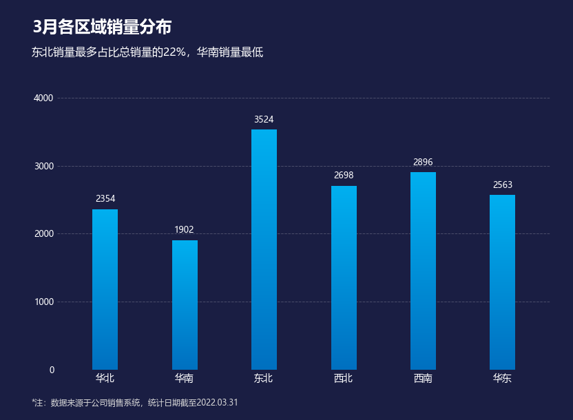 | 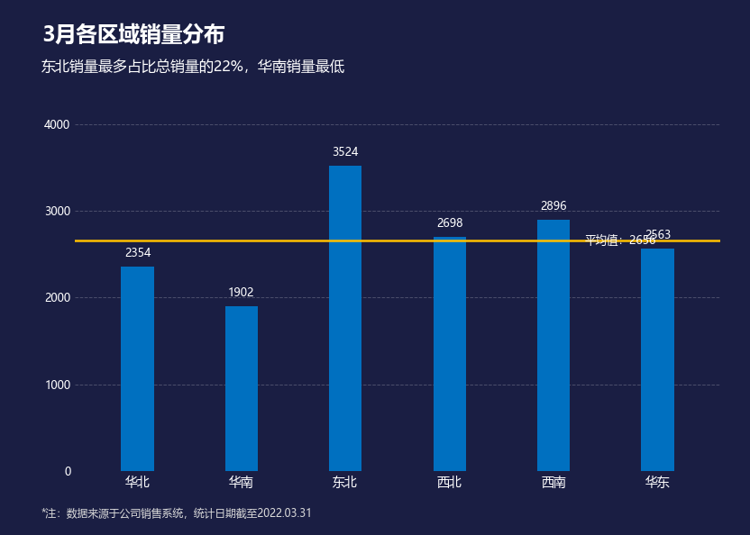 | 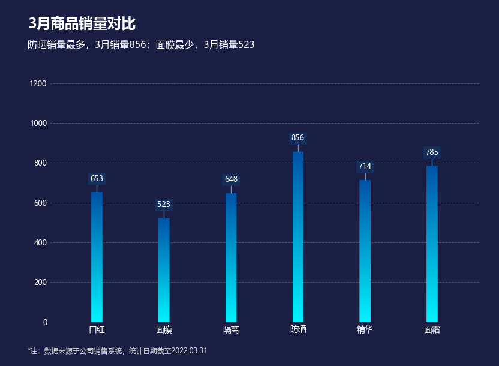 |

| 04 标注柱形图 | 05 层叠柱形图 | 06 蝴蝶图 |
| --- | --- | --- |
| 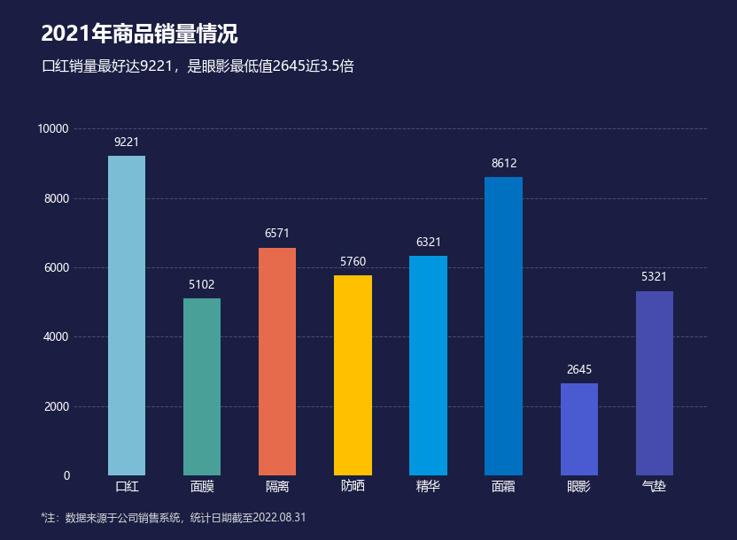 | 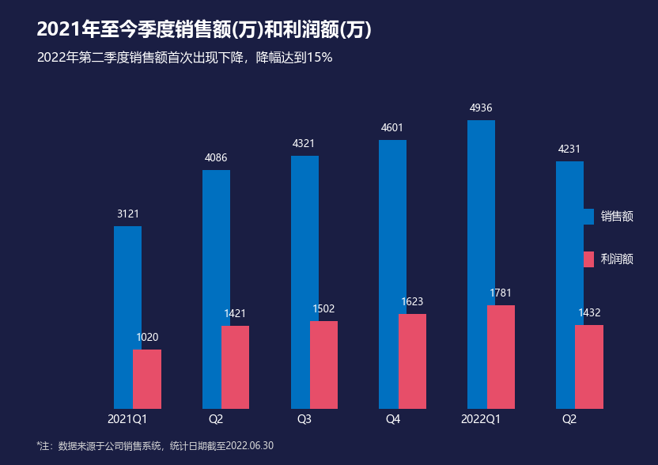 | 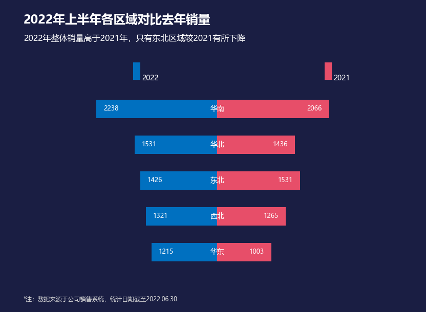 |

| 07 蝴蝶图(28) | 08 数值百分比 | 09 对比柱形图 |
| --- | --- | --- |
| 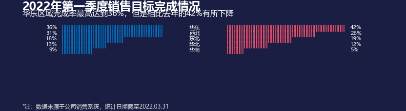 | 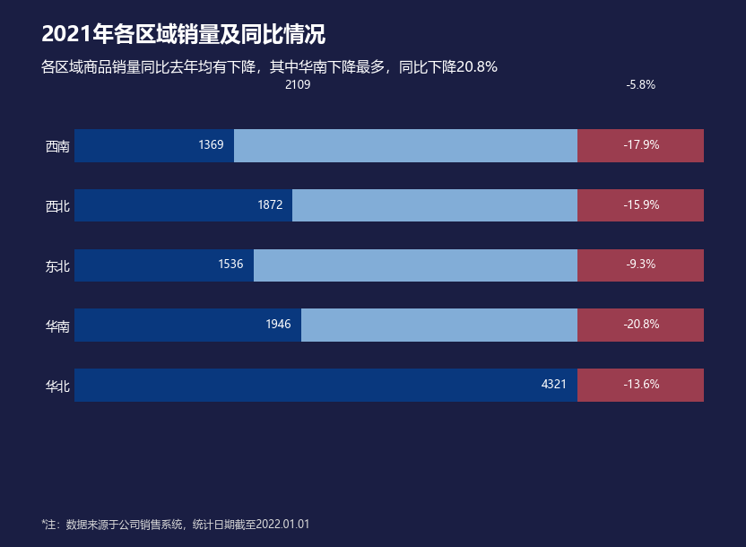 | 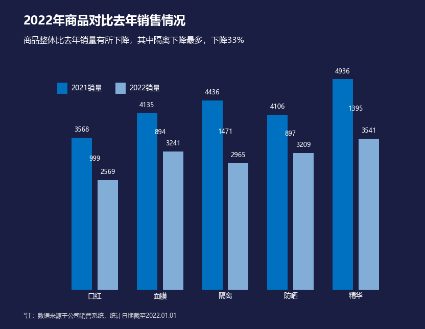 |

| 10 甘特图 | 11 平滑折线图 | 12 菱形走势图 |
| --- | --- | --- |
| 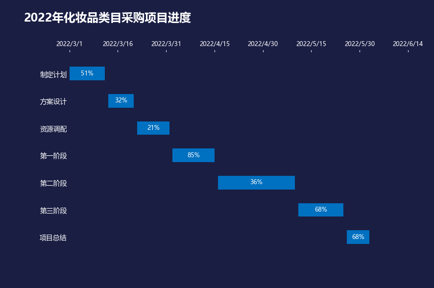 | 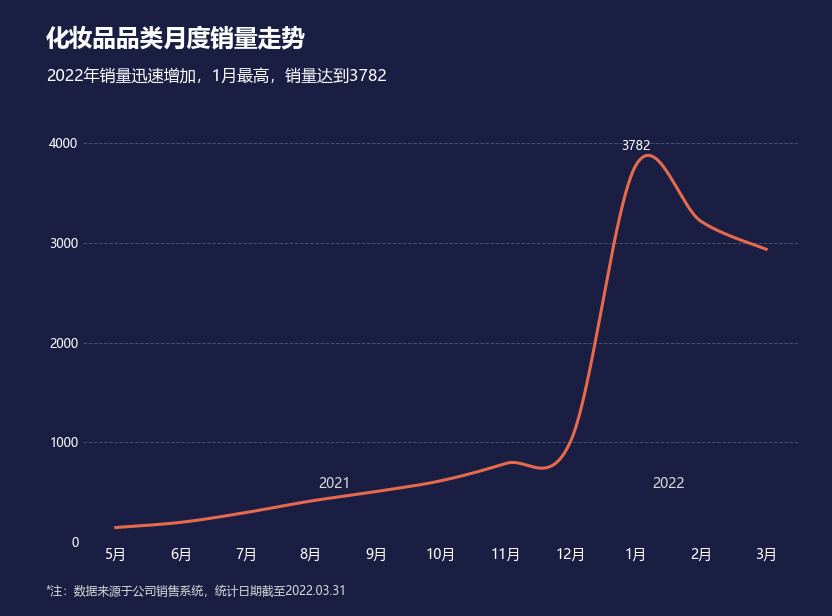 | 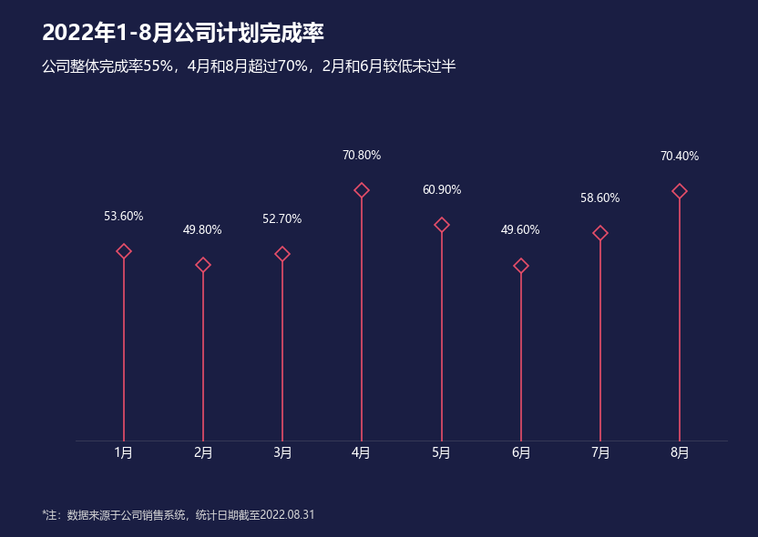 |

| 13 对比折线图 | 14 单值圆环图 | 15 水球图 |
| --- | --- | --- |
| 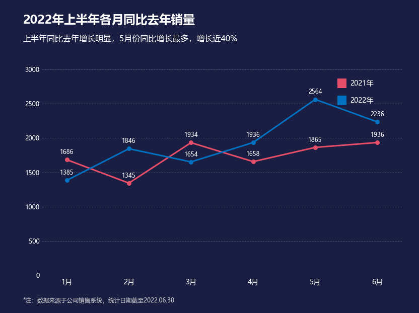 |  |  |

## 文件结构

```
Visualization-Python/
├── 第二章_前15图表复刻.py   # 复刻脚本（单文件，含全部 15 张图的绘制代码）
├── output/                  # 生成的 15 张 PNG
└── README.md
```

> 说明：图片在 GitHub 文件列表里不显示预览，点进文件或在本 README 中查看。
