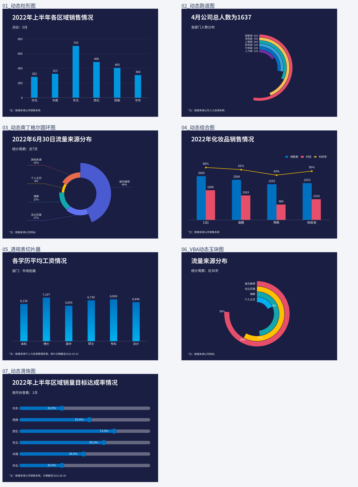

# 第三章 动态图表：Jupyter 可视化复刻

仅处理用户提供的 **《第三章 动态图表.xlsm》**，包含 7 组动态图表。使用 pandas、NumPy、Matplotlib 和 ipywidgets 实现月份、周期、指标与部门筛选，并提供可离线打开的交互预览。



## Jupyter 运行

已验证绘图环境为 **Python 3.12**。解压后保留目录结构，在项目根目录执行：

```bash
python -m pip install -r requirements-notebook.txt
python -m notebook
```

打开 [notebooks/chapter3_dynamic_charts.ipynb](notebooks/chapter3_dynamic_charts.ipynb)，选择 Python 3 内核。先运行公共设置，再执行需要的图表单元格。重新运行后会出现实时控件；文件中已保存的 PNG 只是默认状态预览。

完整绘图函数位于 [src/dynamic_charts.py](src/dynamic_charts.py)，控件位于 [src/widgets_ui.py](src/widgets_ui.py)。无需启用 Excel 宏。

## 离线预览

下载并解压后，双击根目录的 [interactive.html](interactive.html)。页面内含 7 组图表、42 种预生成状态，支持选择、上一项、下一项和自动切换，不需要网络或 Python。

离线预览的部门筛选提供单部门和全部部门；Notebook 支持任意多部门组合。更改 CSV 后，需要重新生成离线预览。

## 七组交互

| 编号 | 示例 | Notebook 交互 | 离线状态数 | 默认状态 |
| --- | --- | --- | --- | --- |
| 1 | 动态柱形图 | 月份下拉框、播放 | 6 | 5 月 |
| 2 | 动态跑道图 | 月份切换 | 4 | 4 月 |
| 3 | 动态南丁格尔圆环图 | 近 7 天 / 近 30 天 | 2 | 近 7 天 |
| 4 | 动态组合图 | 销售额、利润、利润率三个开关 | 8 | 全部显示 |
| 5 | 透视表切片器 | 部门多选、全选、清空 | 8 | 市场拓展 |
| 6 | VBA 动态玉玦图 | 周期按钮，直接切换数据 | 2 | 近 30 天 |
| 7 | 动态滑珠图 | 按月份看区域 / 按区域看月份 | 12 | 1 月各区域 |

## 数据与计算

数据从本次材料提取为 7 份 CSV。项目只包含本章数据，不依赖其他章节或外部工作簿。原始宏工作簿未随项目提交；运行使用 CSV 和提取的样式参数。

人力资源图保留“部门 × 学历”的人数和月收入合计，覆盖原材料的 **1470 条记录**，没有员工号或逐人明细。筛选后的学历平均收入和总计均按 `收入合计 / 人数` 重算，支持精确的部门多选，不是对分组平均值再次简单平均。

| 文件 | 原材料位置 | 内容 |
| --- | --- | --- |
| `data/01_monthly_sales.csv` | 1 动态柱形图 B3:H9 | 6 个月、6 个区域销量 |
| `data/02_department_months.csv` | 2 动态跑道图 B3:F9 | 6 个部门、4 个月人数 |
| `data/03_traffic_periods.csv` | 3 动态南丁格尔圆环图 B3:G5 | 两个周期的五类流量占比 |
| `data/04_products.csv` | 4 动态组合图 B3:F6 | 商品销售额和利润，利润率重新计算 |
| `data/05_hr_department_education.csv` | 5 人力资源明细 | 部门、学历、人数和收入合计 |
| `data/06_yujue_periods.csv` | 6 VBA动态玉玦图 B3:F5 | 两个周期的四类流量占比 |
| `data/07_region_months.csv` | 7 动态滑珠图 B2:H8 | 区域与月份完成率矩阵 |

`data/source_manifest.json` 记录原文件名、SHA-256、工作表名称和默认控件状态；`data/styles.json` 记录源图绘图区、内孔和底色。

## 重新生成与数据更新

只需导出图片和离线 HTML 时：

```bash
python -m pip install -r requirements.txt
python scripts/build.py
```

结果位于 `outputs/charts/` 和 `outputs/interactive.html`。若要同步更新仓库内的示例图片与根目录 HTML：

```bash
python scripts/build.py --update-preview
```

从本地原始材料重新提取数据：

```bash
python scripts/import_excel.py "你的原始工作簿.xlsm"
```

脚本读取数据与样式，不执行宏；重新导入后请重启 Notebook 内核。

## 验证与差异

已执行 7 个默认图、8 个 Notebook Python 单元格和 42 种离线状态；检查了月份变更、指标显示隐藏、加权平均、空筛选、周期切换及矩阵转置。图形默认采用深蓝背景和源图主要配色。

字体、换行、抗锯齿、南丁格尔半径层级、局部标签和控件布局可能与 Excel/WPS 不同，不能保证逐像素一致。源文件含失效的定义名称和部分控件/辅助标题不一致，代码从源数据重算，让筛选项与图形保持一致。详见 [复刻说明](docs/reproduction-notes.md)。

本地验证环境没有 Jupyter 内核与 ipywidgets，Notebook 保存的是真实 Python 绘图得到的静态回退输出，实时控件分支尚未在本地内核验证。GitHub 工作流已配置安装全部依赖并执行 Notebook，远程工作流尚未触发。

```bash
python -m unittest discover -s tests -v
python scripts/check_project.py
```

## 目录

| 路径 | 用途 |
| --- | --- |
| `src/` | 绘图、数据计算、Jupyter 控件与 HTML 模板 |
| `notebooks/` | 七个示例的 Jupyter 入口与默认结果 |
| `data/` | 七份 CSV、源数据记录和样式参数 |
| `assets/charts/` | 七张默认状态 PNG |
| `assets/fonts/` | 中文备选字体及 OFL 许可证 |
| `scripts/` | 数据提取、导出与检查 |
| `tests/` | 动态计算与图形状态检查 |
| `.github/workflows/validate.yml` | 提交后的自动检查配置 |
| `outputs/` | 本地生成文件，默认不提交 |

## 提交到 GitHub

新建空仓库，在解压后的项目目录执行，并把地址替换为自己的仓库：

```bash
git init
git branch -M main
git add .
git commit -m "Add chapter 3 dynamic chart visualizations"
git remote add origin https://github.com/YOUR_USERNAME/chapter3-dynamic-charts.git
git push -u origin main
```

交互实现参考 [ipywidgets 官方文档](https://ipywidgets.readthedocs.io/en/latest/examples/Using%20Interact.html)；工作流参考 [GitHub 官方 Python 文档](https://docs.github.com/en/actions/tutorials/build-and-test-code/python)。
