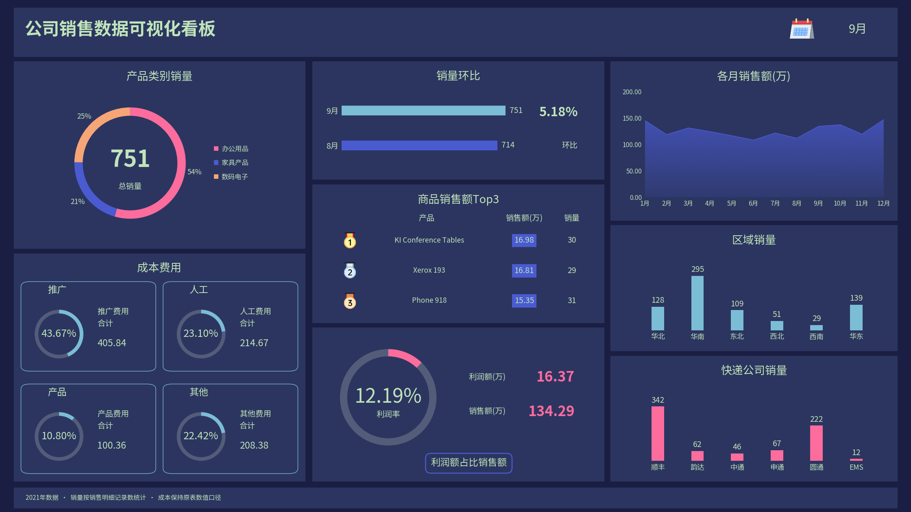

# 第四章 销售数据可视化看板

仅根据《第四章 销售看板参考.xlsx》制作的独立项目，包含 **11 个图表组件、完整销售看板、Jupyter Notebook 和离线月份筛选**。



## 使用

已验证绘图环境为 Python 3.12。在解压后的项目根目录执行：

```bash
python -m pip install -r requirements-notebook.txt
python -m notebook
```

打开 [notebooks/dashboard.ipynb](notebooks/dashboard.ipynb)，选择 Python 3 内核，先运行公共设置，再运行看板和组件图。月份或配色控件更新 STATE，后续单图会沿用当前选择。

也可双击 [dashboard.html](dashboard.html)，离线选择 12 个月与两种配色，支持自动切换月份和下载当前看板。

## 图表与布局

保留原参考大屏的三列布局，默认 9 月。“展示参考”使用第一张展示页的浅绿文字，“原生白字”对应原生看板的白色文字。

| 编号 | 组件 |
| --- | --- |
| 1—4 | 推广、其他、人工、产品费用圆环 |
| 5 | 快递公司销量柱形图 |
| 6 | 区域销量柱形图 |
| 7 | 销量环比条形图 |
| 8 | 各月销售额面积图 |
| 9 | 产品类别销量圆环与总销量 |
| 10 | 商品销售额 Top3 排名表 |
| 11 | 利润率圆环、利润额和销售额 |

原文件的奖牌和日历小图标作为装饰资产保留；所有数据图形由代码绘制，没有用完整看板截图代替绘图。圆环采用源 XML 的 85% 内孔。字体、抗锯齿、局部标签、条形尺度和控件位置可能与办公软件略有不同，不保证逐像素相同。

## 数据与口径

原材料为 **2021 年、8564 条销售记录**，项目按月份和各维度预聚合，未包含订单单号或逐单记录。运行不依赖原始 Excel 或其他章节。

- “销量”按销售明细记录数计算，与原表 COUNTIFS 公式一致，不解释为产品件数。
- 销售额和利润额按原表合计后除以 10000，单位为万；利润率使用利润额合计/销售额合计。
- 原表标注“同比”的 5.18% 实际由 9 月 751 对比 8 月 714 计算，代码统一称为“环比”。1 月没有上月数据时显示“—”，不填成 0%。
- 成本明细未明确写出单位，保留原始数值及占比，不与以万计的销售额直接相减。
- 环比条形从零开始按实际记录数绘制，避免条长夸大变化。
- Top3 以当前月份商品销售额排序，同额时按产品名稳定排序。

默认 9 月核对值：销量 751、销售额 134.28874355 万、利润额 16.3746218635 万、利润率约 12.19359228%、成本合计 929.246896（原表口径）。

## 目录

| 路径 | 内容 |
| --- | --- |
| `src/dashboard.py` | 月份汇总、11 个组件和完整看板 |
| `src/_style.py` | 中文字体、卡片和圆环工具 |
| `src/widgets_ui.py` | Jupyter 月份与配色控件 |
| `data/` | 月度、区域、快递、类别、产品和成本汇总 CSV |
| `assets/charts/` | 11 张默认组件图 |
| `assets/dashboard.png` | 默认完整看板 |
| `assets/icons/` | 原参考文件的小图标 |
| `assets/fonts/` | 中文备选字体与 OFL 许可证 |
| `scripts/` | 数据提取、导出与检查 |
| `tests/` | KPI、各月汇总和环比检查 |
| `outputs/` | 本地重生成结果，默认不提交 |

`data/source_manifest.json` 记录源文件名、SHA-256、统计范围、原图默认 KPI 和显示顺序。

## 导出与更新

```bash
python -m pip install -r requirements.txt
python scripts/build.py
```

结果为 `outputs/dashboard.png`、`outputs/charts/` 和 `outputs/dashboard.html`。

```bash
python scripts/import_excel.py "你的原始工作簿.xlsx"
python scripts/build.py --update-preview
```

重新提取同结构数据后请重启 Notebook 内核。历史年度、统计口径和模板样式说明以当前材料为准。

## 检查

```bash
python -m unittest discover -s tests -v
python scripts/check_project.py
```

已执行默认看板、11 张组件图及 24 个月份/配色状态。测试核对每月区域、快递、类别、商品销量及金额与月度总计一致，并与原图默认 KPI 对照。

Notebook 保存实际 Python 绘图输出。本地无 Jupyter 内核和 ipywidgets，控件以静态回退分支验证，实时分支尚未本地内核测试；GitHub Actions 已配置内核执行，远程工作流尚未触发。

